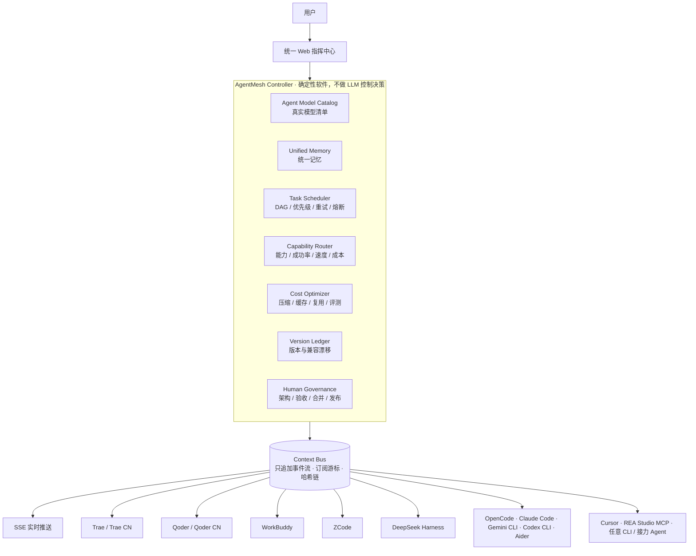

<div align="center">

# AgentMesh OS

**把本机所有 AI Agent 编成一张网：一个入口，统一规划、调度、记忆、验证与成本控制。**

[](https://www.python.org/)
[](#快速开始)
[](#测试)
[](#agent-接入矩阵)
[](#许可)

[快速开始](#快速开始) · [核心能力](#核心能力) · [架构](#架构) · [Agent 接入矩阵](#agent-接入矩阵) · [Web 控制台](#web-控制台) · [CLI](#cli-速查) · [文档](#文档)

<sub>AgentMesh OS is a local-first, user-sovereign control plane that orchestrates every AI coding agent installed on your machine — Trae, Qoder, WorkBuddy, ZCode, DeepSeek Harness, OpenCode, Claude Code, Gemini CLI, Codex CLI, Aider, Cursor and any CLI agent — behind a single deterministic controller.</sub>

</div>

---

## 为什么需要 AgentMesh OS

你机器上可能同时装着 Trae、Qoder、WorkBuddy、OpenCode、Claude Code、Codex CLI……每个都有自己的会话、模型、额度和上下文。结果是：

- **重复劳动**：同一份需求在多个 Agent 之间来回粘贴，上下文靠人肉搬运。
- **黑盒失控**：Agent 说“已完成”，但你不知道它改了哪些文件、验证了什么、证据在哪。
- **成本不可见**：哪个模型贵、哪个免费额度还能用、哪次运行烧了多少 token，全靠猜。
- **无法复现**：同样一句话，今天跑通、明天换模型就崩，没有任何确定性边界。

AgentMesh OS 的做法是：**把“谁来做、用什么模型、按什么顺序、如何验收、花了多少”从 Agent 手里收回来，交给一个不调用 LLM 的确定性控制器。** 用户只面对一个 Web 指挥中心，其余 Agent 全部降级为可调用资源。

## 核心能力

| 能力 | 说明 |
| --- | --- |
| 🎛 **单一入口** | 一个 Web 指挥中心完成「项目 → Prompt → 主/子 Agent 与模型 → 审批/运行 → 实时监控」全流程 |
| 🧠 **角色化编排** | 主节点只做规划、决策、汇总；执行按角色的 `(档位, Agent, 模型)` 阶梯自动选型，失败沿阶梯升级 |
| 🔀 **多 Agent 链路** | 按阶段锁定 Agent + 真实模型，DAG 调度、依赖、优先级、并行、重试、熔断，同一 Agent 自动续接会话 |
| 🖥 **零输入 GUI 自动化** | Trae / Qoder CN / WorkBuddy 通过应用自身接口（`state.vscdb`、CDP DOM、deeplink）执行，不合成 OS 键鼠 |
| ✅ **确定性验证** | 17 字段结构化成果包 + 控制平面验证（scope / patch / 命令 / 证据），可选独立 Agent 复审 |
| 🌿 **Worktree 隔离** | 每个子任务独立 Git Worktree；统一 Patch、范围租约、合并预检与回滚 |
| 🧩 **统一记忆** | 五级同步：消息 → 任务状态 → 项目索引/代码结构 → 知识/决策 → 工作流；Agent 启动自动注入引导包 |
| 📡 **Context Bus** | 只追加事件流 + 持久订阅 + 游标消费 + 回放 + 哈希链，SSE 实时推送 |
| 💰 **成本闭环** | 精确缓存、语义缓存（本地嵌入 768 维）、上游成果复用、Agent Benchmark、美元节省入账 |
| 🛡 **人类治理** | 架构 / 验收 / 合并 / 发布四道人类门禁；发布门禁只记录决定，不自动部署 |
| 🔁 **多轮续跑** | 主节点判定未通过时带失败证据增量重规划，同一运行内继续执行、复审、汇总 |
| 📚 **真实模型目录** | 从 CLI、会话事件、provider 配置真实提取，不内置、不猜测、不读取密钥 |

## 架构



**分层职责**

```text
用户
 │
 ▼
统一 Web 指挥中心（项目 → Prompt → 主/子 Agent 与模型 → 审批/运行 → 实时监控）
 │
 ▼
AgentMesh Controller（确定性软件）
 ├── Agent Model Catalog  真实探测 / 用户登记的主、子 Agent 模型清单
 ├── Unified Memory      统一记忆层
 ├── Task Scheduler      依赖 / 优先级 / 重试 / 熔断
 ├── Capability Router   能力 / 成功率 / 验证 / 速度 / 成本
 ├── Cost Optimizer      压缩 / 语义缓存 / 结果复用 / 基准评测
 ├── Version Ledger      Agent 软件版本、指纹与升级兼容漂移
 └── Human Governance    架构 / 验收 / 合并 / 发布审批
 │
 ▼
Context Bus（只追加事件流 + 订阅游标 + 哈希链） ── SSE 实时推送
 │
 ▼
Trae · Qoder · WorkBuddy · ZCode · DeepSeek Harness · OpenCode
Claude Code · Gemini CLI · Codex CLI · Cursor · Aider · REA Studio (MCP) · 任意 CLI/接力 Agent
```

## Agent 接入矩阵

等级：**L0** 人工接力 / **L1** 文件协同 / **L2** 结构化任务协同 / **L3** 会话级协同 / **L4** 原生双向（本期不承诺）。

| Agent | 存储 / CLI | 等级 | 适配方式 |
| --- | --- | --- | --- |
| Trae / Trae CN | `state.vscdb` + `ModularData/ai-agent/database.db` | **L3 GUI** | CDP DOM 发送 + 状态库工作区/模型写入；会话只读解密 |
| Qoder / Qoder CN | `~/.qoder{,-cn}/projects/**/*.jsonl` | L2 / **L3 GUI** | 文件接力 + 会话读取；CN 版 `gui_automation` |
| ZCode | `resources\glm\zcode.cjs` + `~/.zcode/cli/db/db.sqlite` | **L3** | headless CLI（`zcode -p --json`）+ 临时 provider 配置模型 pinning + 会话续接 |
| WorkBuddy | `~/.workbuddy/projects/**/*.jsonl` + `workbuddy.db` | **L3 GUI** | `gui_automation`：模型菜单 + transcript/DB 回读 |
| DeepSeek Harness | `~/.dsh/sessions/**/*.jsonl.zstd` | **L3** | headless CLI（`--json` 事件流 + `--session-id` 续接） |
| OpenCode | `opencode run --format json` | **L3** | CLI 非交互执行，`--session` 对话级续接 |
| Claude Code | `claude -p` | L3（安装才启用） | CLI 非交互执行 |
| Gemini CLI | `gemini -p` | L3（安装才启用） | CLI 非交互执行 |
| Codex CLI | `codex exec` | L3（安装才启用） | CLI 非交互执行 |
| Aider | `aider --message` | L3（安装才启用） | CLI 非交互执行 |
| Cursor | `cursor` / 安装目录 | L1–L2 | 文件接力；不读取私有状态 |
| REA Studio | 项目级 `.mcp.json`（`rea-agents` 6.8.0） | L2 | MCP stdio：真实 `tools/list` / `tools/call`（229 个工具） |

> 本机审计实测（2026-11-03）：探测到 **14 个 Agent、93 个真实模型**。模型清单只来自 CLI 输出、Agent 会话事件、Agent 自身 provider/settings 配置或用户手动登记——不内置、不猜测、不读取密钥。

## 快速开始

**要求**：Windows 10/11 x64、Python ≥ 3.10、Git。
**必需依赖**：PyYAML、cryptography、zstandard。
**可选**：本地真语义缓存需 `torch` + `transformers` + 本机 EmbeddingGemma-2 模型（缺失自动降级词袋）；MCP Server 需 `mcp` 包（缺失不影响 CLI/Web）。

```powershell
git clone https://github.com/jimmiewkj-hue/agentmesh-os.git
cd agentmesh-os

python -m pip install -r requirements.txt
python -m pip install -e          # 让任意项目目录可直接运行 python -m agentloop_hub
```

### 方式 A：Web 指挥中心（推荐）

```powershell
python -m agentloop_hub serve --port 8787
# 浏览器打开 http://127.0.0.1:8787
```

在「指挥中心 → 项目目录」输入路径并点击「初始化项目」：自动创建目录、`git init`、生成初始 commit，随后探测本机 Agent 与真实模型清单。

### 方式 B：CLI

```powershell
cd <你的 Git 项目>
python -m agentloop_hub init                          # 创建工作空间，探测本机 Agent
python -m agentloop_hub connectors                    # 统一能力清单
python -m agentloop_hub models --sync                 # 同步真实模型目录（含显示名/倍率）
python -m agentloop_hub main set opencode --model opencode/deepseek-v4.1-flash-free

python -m agentloop_hub ask "修复 calc.py 中的加法错误并补充测试"
python -m agentloop_hub plan approve <plan_id>
python -m agentloop_hub run start <run_id> --parallel 2
python -m agentloop_hub approval list                 # 验收 → 合并 → 发布
```

### 一条命令跑完整闭环

```powershell
agentmesh solve "给这个仓库补一个 REST 健康检查接口，并写测试" `
  --executor qoder_cn:DeepSeek-Flash `
  --commander workbuddy:glm-5.3
```

切分 → 角色选型 → 钉住模型 → 按 DAG 运行 → 汇总答案，一次完成。

## Web 控制台

默认进入**指挥中心**，五步完成一次闭环：

| 步骤 | 内容 |
| --- | --- |
| **1 项目目录** | 输入路径，一键初始化（创建目录 + `git init` + 初始 commit）或打开已有 Git 项目；页面内目录选择器支持盘符 / 面包屑 / 最近打开 |
| **2 原始 Prompt** | 直接输入需求，主 Agent 生成结构化计划（N 个任务，进入待审批） |
| **3 主 / 子 Agent 与模型** | 主 Agent 负责规划；每个子 Agent 从真实模型清单中选配模型、上下文窗口与能力等级 |
| **3.5 多 Agent 链路** | 从计划载入 N 个阶段，逐阶段锁定 Agent / 模型 / 任务类型，保存为待审批草稿（刷新不丢，此处不执行） |
| **4 审批与运行** | 唯一执行入口：批准计划 → 开始执行 → 验收 → 合并 → 发布；节点需人工处理时阻塞并弹窗，完成后自动续跑 |
| **5 实时监控** | SSE 推送 Context Bus 事件、Agent 日志、任务状态、成本、审批、版本漂移 |

高级视图：Agent 管理（含 MCP 工具台）、Agent 版本、任务图、任务详情、人类治理、Context Bus、成本与审计。

## CLI 速查

| 命令 | 说明 |
| --- | --- |
| `agentmesh init` / `status` / `doctor` | 项目、总览、健康检查（含总线哈希链） |
| `agentmesh connectors` | 统一 Connector Manifest（统一 `{agent_id, capability[]}`） |
| `agentmesh models [--refresh\|--sync]` | 本机真实模型清单（主/子 Agent 选配依据） |
| `agentmesh versions [--status]` | Agent 版本台账、升级漂移 |
| `agentmesh ask "<目标>"` | 单一入口：生成计划与审批 |
| `agentmesh solve "<目标>"` | 单入口闭环：切分 → 角色选型 → 运行 → 汇总 |
| `agentmesh segment "<目标>"` | 只看切分与选型，不运行 |
| `agentmesh roles list/resolve/import/save` | 角色策略：候选阶梯、导入 OpenCode / AGENTS.md、落盘 |
| `agentmesh main set <agent> --model <model>` | 指定主节点与主模型 |
| `agentmesh plan request/import/approve/reject` | 规划与批准 |
| `agentmesh run start/resume/status` | 执行任务图 |
| `agentmesh task list/show/result/retry/cancel` | 任务与成果 |
| `agentmesh route rank/task/scores/decisions` | 能力路由 |
| `agentmesh bus list/stats/verify/subscribe/poll/publish/replay` | Context Bus |
| `agentmesh search "<query>"` | 控制平面联网检索（子节点可经 API 调用） |
| `agentmesh benchmark` | Agent 基准评测 |
| `agentmesh costs` / `cache stats/clear` | 成本、节省、语义缓存 |
| `agentmesh approval list/approve/reject` | 人类治理 |
| `agentmesh release <run_id>` | 发布审批（合并后可用） |
| `agentmesh sync [--agent ID]` / `memory bootstrap` | 五级同步、启动引导包 |
| `agentmesh session import/list` | 历史会话 |
| `agentmesh memory list/add/search/update/delete/export` | 统一记忆 |
| `agentmesh mcp-serve --project <path>` | stdio MCP Server：`memory_*` / `web_search` / `task_state` / `bus_events` |
| `agentmesh merge/rollback` / `recover` / `audit --verify` | 合并、回滚、恢复、审计 |
| `agentmesh serve` | Web 控制台 |

所有查询命令支持 `--json`；`--project` 可放在子命令前后。

## 目录与数据

```text
<项目>/.agentloop/
├── project.yaml
├── state.db                 # 任务/审批/预算/审计/记忆/会话/总线/路由/缓存/基准
├── tasks/<run>_<task>/      # 任务包、提示词、成果包、日志
├── runs/<run>/worktrees/    # 每个子任务独立 Worktree
├── patches/                 # 统一 Patch
├── reports/                 # 验证报告
├── checkpoints/             # 检查点快照
├── handoffs/                # 主节点交接包
├── relay/<task>/inbox|outbox# L2 接力文件
├── conversations/           # 归一化历史会话归档
└── audit/                   # 追加式审计（存于 state.db）
```

`.agentloop/` 与 `.agentloop-task/` 会写入 `.git/info/exclude`，不污染项目 Git 状态。

## 测试

```powershell
python -m pytest
```

本机结果：**578 passed, 1 skipped**（2026-11-10，`tests` + `verification` 联合入口，458s）。

覆盖：Connector 清单、路由评分、总线订阅/回放/只追加、调度优先级、语义缓存、节省账本、Benchmark、五级记忆同步、架构/验收/发布门禁、Worktree/Patch、DAG、重试、熔断、预算、审批、验证、合并、回滚、恢复、交接、会话读取、HTTP API、CLI、项目初始化/切换、模型目录选配、版本漂移、MCP 工具发现/调用、GUI 适配器（stub 驱动）、SSE 实时流，以及角色策略解析、确定性切分、任务级模型派发、失败升级、预算降级、多轮续跑、增量规划、跨轮补丁合并、链路绑定、配置草稿持久化、启动器重启保护、WorkBuddy 完成终态校验、活动会话串行化、PowerShell 验证、Trae 登录墙检测、长思考存活检测、OpenCode 对话级续接、合成冲突保留会话、dsh headless 适配、联网检索、美元节省入账、本地嵌入语义缓存、MCP stdio Server。

## 安全边界与已知限制

- GUI 自动化仅用于用户本机已安装、已登录的 Trae / Trae CN / Qoder CN / WorkBuddy：通过应用自身接口（CDP DOM、状态库、deeplink）操作，**不破解应用、不修改其私有存储**；无法确认的工作区信任弹窗会阻塞交还人类；截图与 transcript 仅作执行证据。
- 不承诺读取第三方 Agent 的私有隐藏状态或写入其会话；会话读取与 GUI 回读均为只读归档。
- 子任务在独立 Worktree 中执行，控制平面在合并前检查范围、补丁可应用性、命令验证与证据；但 Agent 进程本身仍运行在用户账户下，**不是强沙箱**。
- 运行仍要求 Git（Worktree/Patch 隔离）；非 Git 目录可在 Web 控制台一键初始化，CLI `init` 会明确拒绝非 Git 目录。
- 发布审批只是人类门禁记录，不自动执行部署/推送。
- 语义缓存只对只读任务、同一文件基线、相似意图生效；写任务不会自动复用成果。
- 本期未实现多电脑同步、团队权限、云端调度等 P2 能力。

## 工程实录（真实链路验证）

这个项目不是 demo，每一步都留了可复现的证据：

- **Trae CN + `deepseek-v4.1-flash`**：CDP 页面级事件打开应用自身模型菜单并点选，回读 `.model-select-area-model` 确认后发送；实测产出完整成果包（发现 `add()` 返回 `a - b`、执行 `python -c` 验证、列出证据），控制平面验证 `passed`。
- **Qoder CN + `gfmodel`**：CDP 零输入发送，transcript 回读 `model` / `workspace-directories` / `completed=true`，验证 `passed`。
- **OpenCode**：CLI 直连 7.3s 返回预期内容；会话级续接由真实探针验证（同会话 ID + 正确回忆上一轮）。
- **ZCode**：headless CLI 真实任务 42s 完成，`db.sqlite` 只读回读双确认。
- **DeepSeek Harness**：headless 端到端跑通，Agent 实际写出 `result.json`，真实 usage 解析与续接回忆均验证。

更多细节见 [Agent 软件接口逆向实测](docs/Agent软件接口逆向实测.md)、[验证日志](docs/验证日志.md)。

## 文档

| 文档 | 内容 |
| --- | --- |
| [使用说明书（完整版）](docs/使用说明书-完整版.md) | 从安装到编排的完整操作路径 |
| [用户使用手册](docs/用户使用手册.md) | 日常使用与常见问题 |
| [概要设计](docs/概要设计.md) | 架构、模块划分与需求追溯 |
| [实现与测试报告](docs/实现与测试报告.md) | 逐模块实现与测试证据 |
| [验证日志](docs/验证日志.md) | 真实链路逐条验证记录 |
| [11 类 Agent 能力矩阵](docs/11类Agent能力矩阵.md) | 各 Agent 能力与适配强度 |
| [Agent 软件接口逆向实测](docs/Agent软件接口逆向实测.md) | CDP / 状态库 / deeplink 实测 |
| [GUI 自动化实测报告](docs/GUI自动化实测报告.md) | 窗口驱动、模型选择、回读与取证 |
| [角色路由与成本编排](docs/角色路由与成本编排.md) | 角色阶梯、预算降级、成本闭环 |
| [链路配置与阻塞恢复](docs/链路配置与阻塞恢复.md) | 多 Agent 链路、阻塞、续接与恢复 |
| [多轮对话与完成判定](docs/多轮对话与完成判定.md) | 多轮续跑与完成判定 |
| [完全控制与权限自动接受](docs/完全控制与权限自动接受.md) | `full_control` 权限策略 |
| [ZCode 自动化触发](docs/ZCode自动化触发.md) | headless CLI 与模型 pinning |
| [工作目录选择器](docs/工作目录选择器.md) | 页面内目录浏览与安全边界 |
| [WebUI 真实使用测试](docs/WebUI真实使用测试-清明上河图.md) | 端到端真实项目回归 |
| [真实链路缺陷修复记录](docs/真实链路缺陷修复记录-2026-11-08.md) | 11 项缺陷与修复证据 |
| [需求差距与独立验证报告](docs/需求差距与独立验证报告.md) | 需求覆盖与差距分析 |
| [Trae 接入方案分析](docs/Trae接入方案分析-dsh-connect-trae-plus.md) | 与第三方桥接插件的取舍 |

## 许可

[MIT](LICENSE)（仅本项目代码；第三方 Agent 的使用须遵守其各自服务条款）。
